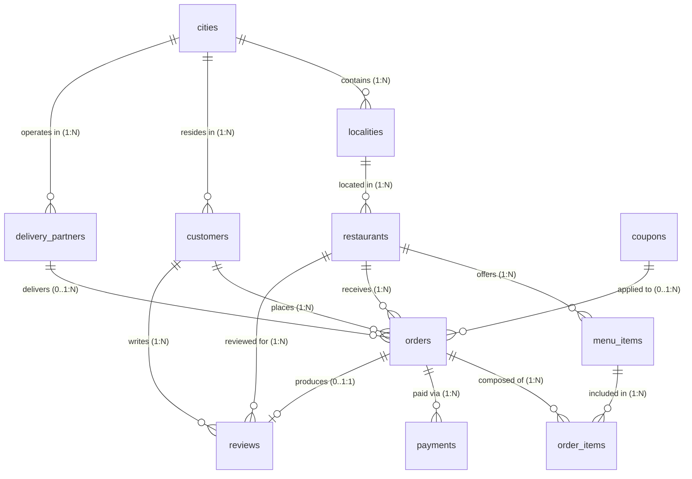

# Phase 2: Schema Design, Data Dictionary & Normalization Report

**Course:** Database Management Systems (DBMS)  
**Project:** Zomato Food Delivery Database  
**Team:** T0002 (Piyush Tharwani, Anubhav Jaiswal, Aadarsh, Prince Goswami)  
**Deliverable:** `docs/02_schema_design.md`

---

## 1. Relational Entity-Relationship Diagram (ERD)

The relational model consists of 11 normalized tables structured in the `zomato` PostgreSQL schema:



### Key Relationships & Cardinalities:
1. **Cities $\to$ Localities (1:N):** A city has multiple distinct operational localities/neighborhoods; each locality belongs to exactly one city.
2. **Localities $\to$ Restaurants (1:N):** Each restaurant is physically situated in one locality with an assigned pincode.
3. **Restaurants $\to$ Menu Items (1:N):** A restaurant defines its catalog of menu items; `ON DELETE CASCADE` ensures menu items are removed if a restaurant record is purged.
4. **Customers $\to$ Orders (1:N):** A customer can place multiple orders over time; protected by `ON DELETE RESTRICT` to prevent accidental deletion of historical accounts.
5. **Restaurants $\to$ Orders (1:N):** A restaurant receives orders; protected by `ON DELETE RESTRICT`.
6. **Delivery Partners $\to$ Orders (0..1:N):** Orders start unassigned (`partner_id IS NULL`) until assigned to an active rider; `ON DELETE SET NULL` preserves order records if partner accounts are closed.
7. **Coupons $\to$ Orders (0..1:N):** Orders may optionally use a single valid coupon code (`coupon_code IS NULL` if no discount applied).
8. **Orders $\to$ Order Items (1:N):** An order contains one or more line items; identified by composite primary key `(order_id, item_id)`.
9. **Orders $\to$ Payments (1:N):** An order can have multiple payment attempts (e.g., failed card attempt followed by successful UPI attempt).
10. **Orders $\to$ Reviews (0..1:1):** Each delivered order may produce at most one customer feedback review.

---

## 2. Comprehensive Data Dictionary

### Table 1: `cities` (10 rows)
Stores the operational metropolitan areas where Zomato operates.
| Column | Data Type | Constraints | Rationale & Description |
|---|---|---|---|
| `city_id` | `INT` | `PRIMARY KEY` | Surrogate identifier for each city. |
| `city_name` | `VARCHAR(50)` | `NOT NULL`, `UNIQUE` | Official city name (e.g., Bengaluru, Mumbai, Delhi). |
| `state` | `VARCHAR(50)` | `NOT NULL` | State jurisdiction within India. |

---

### Table 2: `localities` (100 rows)
Neighborhood delivery clusters inside each operational city.
| Column | Data Type | Constraints | Rationale & Description |
|---|---|---|---|
| `locality_id` | `INT` | `PRIMARY KEY` | Surrogate identifier for each delivery locality. |
| `city_id` | `INT` | `NOT NULL`, `REFERENCES cities(city_id) ON DELETE RESTRICT` | Parent city foreign key. |
| `locality_name`| `VARCHAR(100)`| `NOT NULL` | Locality name (e.g., Koramangala, Indiranagar). |
| `pincode` | `VARCHAR(10)` | `NOT NULL` | Postal PIN code for geographical sorting. |
| *Composite* | — | `UNIQUE (city_id, locality_name)` | Prevents duplicate locality entries within the same city. |

---

### Table 3: `customers` (25,000 rows)
Registered user accounts ordering on the platform.
| Column | Data Type | Constraints | Rationale & Description |
|---|---|---|---|
| `customer_id` | `INT` | `PRIMARY KEY` | Unique customer identity. |
| `full_name` | `VARCHAR(100)`| `NOT NULL` | Customer's full name. |
| `email` | `VARCHAR(150)`| `NOT NULL`, `UNIQUE` | Case-insensitive registered email for communication and login. |
| `phone` | `VARCHAR(20)` | `NOT NULL`, `UNIQUE` | Primary mobile contact number for delivery coordination. |
| `city_id` | `INT` | `NOT NULL`, `REFERENCES cities(city_id) ON DELETE RESTRICT` | Default operating city. |
| `signup_date` | `DATE` | `NOT NULL` | Account registration calendar date. |
| `is_gold_member`| `BOOLEAN`| `NOT NULL DEFAULT FALSE` | Flag for Zomato Gold premium membership benefits. |
| `gold_expires_on`| `DATE` | `NULLABLE` | Expiration date of active Gold membership (NULL for non-members). |
| `is_active` | `BOOLEAN` | `NOT NULL DEFAULT TRUE` | Soft-state account status. |
| *Check* | — | `CHECK (is_gold_member = FALSE OR gold_expires_on IS NOT NULL)` | Enforces expiration date presence for Gold members. |

---

### Table 4: `delivery_partners` (2,000 rows)
Delivery riders fulfilling logistical transport from restaurants to customers.
| Column | Data Type | Constraints | Rationale & Description |
|---|---|---|---|
| `partner_id` | `INT` | `PRIMARY KEY` | Unique rider identifier. |
| `full_name` | `VARCHAR(100)`| `NOT NULL` | Rider's full name. |
| `phone` | `VARCHAR(20)` | `NOT NULL`, `UNIQUE` | Dedicated contact number. |
| `city_id` | `INT` | `NOT NULL`, `REFERENCES cities(city_id) ON DELETE RESTRICT` | Assigned operational city base. |
| `vehicle_type`| `VARCHAR(20)`| `NOT NULL`, `CHECK (vehicle_type IN ('BIKE', 'SCOOTER', 'EV', 'BICYCLE'))` | Vehicle classification for range/speed estimations. |
| `joined_on` | `DATE` | `NOT NULL` | Date rider onboarded onto the fleet. |
| `rating` | `NUMERIC(2,1)`| `NOT NULL`, `CHECK (rating >= 1.0 AND rating <= 5.0)` | Average performance score (1.0 to 5.0). |
| `status` | `VARCHAR(20)` | `NOT NULL`, `CHECK (status IN ('ACTIVE', 'INACTIVE', 'BLOCKED'))` | Current operational fleet status. |

---

### Table 5: `coupons` (30 rows)
Promotional discount voucher codes.
| Column | Data Type | Constraints | Rationale & Description |
|---|---|---|---|
| `coupon_code` | `VARCHAR(50)` | `PRIMARY KEY` | Alphanumeric promotional voucher key (e.g., DINNER150). |
| `discount_pct`| `NUMERIC(5,2)`| `NOT NULL`, `CHECK (discount_pct > 0 AND discount_pct <= 100)` | Percentage discount rate. |
| `max_discount`| `NUMERIC(10,2)`| `NOT NULL`, `CHECK (max_discount > 0)` | Maximum permissible monetary discount cap in ₹. |
| `min_order_value`| `NUMERIC(10,2)`| `NOT NULL`, `CHECK (min_order_value >= 0)` | Minimum cart subtotal required to activate coupon. |
| `valid_from` | `DATE` | `NOT NULL` | Promotional start date. |
| `valid_to` | `DATE` | `NOT NULL` | Promotional expiration date. |
| *Check* | — | `CHECK (valid_to >= valid_from)` | Temporal validity sanity constraint. |

---

### Table 6: `restaurants` (2,500 rows)
Merchant partner eateries listed on the Zomato platform.
| Column | Data Type | Constraints | Rationale & Description |
|---|---|---|---|
| `restaurant_id`| `INT` | `PRIMARY KEY` | Unique restaurant merchant ID. |
| `name` | `VARCHAR(150)`| `NOT NULL` | Registered trading name. |
| `locality_id` | `INT` | `NOT NULL`, `REFERENCES localities(locality_id) ON DELETE RESTRICT` | Geographical operating zone. |
| `cuisines` | `TEXT[]` | `NOT NULL` | Array of offered food styles (e.g., `{"North Indian", Mughlai}`). |
| `avg_cost_for_two`| `NUMERIC(10,2)`| `NOT NULL`, `CHECK (avg_cost_for_two > 0)` | Estimated price for two diners in ₹. |
| `rating` | `NUMERIC(2,1)`| `CHECK (rating IS NULL OR (rating >= 1.0 AND rating <= 5.0))` | Cached aggregate customer review rating (NULL if unrated). |
| `rating_count` | `INT` | `NOT NULL DEFAULT 0`, `CHECK (rating_count >= 0)` | Total number of published reviews. |
| `opens_at` | `TIME` | `NOT NULL` | Daily operational opening time. |
| `closes_at` | `TIME` | `NOT NULL` | Daily operational closing time. |
| `is_pure_veg` | `BOOLEAN` | `NOT NULL DEFAULT FALSE` | Quick search filter flag for pure vegetarian dining. |
| `status` | `VARCHAR(30)` | `NOT NULL`, `CHECK (status IN ('OPEN', 'TEMPORARILY_CLOSED', 'DELISTED'))` | Real-time merchant store status. |
| `onboarded_on` | `DATE` | `NOT NULL` | Platform onboarding date. |

---

### Table 7: `menu_items` (50,000 rows)
Dish and beverage offerings across all restaurant partner menus.
| Column | Data Type | Constraints | Rationale & Description |
|---|---|---|---|
| `item_id` | `INT` | `PRIMARY KEY` | Unique dish identifier. |
| `restaurant_id`| `INT` | `NOT NULL`, `REFERENCES restaurants(restaurant_id) ON DELETE CASCADE` | Owning restaurant entity. |
| `item_name` | `VARCHAR(150)`| `NOT NULL` | Name of the dish (e.g., "Dal Makhani", "Paneer Tikka"). |
| `category` | `VARCHAR(50)` | `NOT NULL`, `CHECK (category IN ('Starters', 'Main Course', 'Rice', 'Breads', 'Desserts', 'Beverages'))` | Standardized menu section classification. |
| `price` | `NUMERIC(10,2)`| `NOT NULL`, `CHECK (price >= 0)` | Base unit price in ₹. |
| `is_veg` | `BOOLEAN` | `NOT NULL DEFAULT FALSE` | Dietary vegetarian tag. |
| `is_bestseller`| `BOOLEAN` | `NOT NULL DEFAULT FALSE` | Algorithmic popularity badge. |
| `is_available` | `BOOLEAN` | `NOT NULL DEFAULT TRUE` | Real-time kitchen in-stock toggle. |

---

### Table 8: `orders` (150,000 rows)
Core transaction ledger capturing food ordering, logistics, and billing.
| Column | Data Type | Constraints | Rationale & Description |
|---|---|---|---|
| `order_id` | `BIGINT` | `PRIMARY KEY` | High-capacity surrogate order identifier. |
| `customer_id` | `INT` | `NOT NULL`, `REFERENCES customers(customer_id) ON DELETE RESTRICT` | Placing customer. |
| `restaurant_id`| `INT` | `NOT NULL`, `REFERENCES restaurants(restaurant_id) ON DELETE RESTRICT`| Fulfilling kitchen. |
| `partner_id` | `INT` | `NULLABLE`, `REFERENCES delivery_partners(partner_id) ON DELETE SET NULL` | Assigned courier (NULL before assignment). |
| `coupon_code` | `VARCHAR(50)` | `NULLABLE`, `REFERENCES coupons(coupon_code) ON DELETE SET NULL` | Applied discount coupon. |
| `placed_at` | `TIMESTAMPTZ` | `NOT NULL` | Order checkout submission timestamp with timezone. |
| `accepted_at` | `TIMESTAMPTZ` | `NULLABLE` | Restaurant acceptance timestamp (NULL if pending/rejected). |
| `picked_up_at`| `TIMESTAMPTZ` | `NULLABLE` | Courier pickup from kitchen timestamp. |
| `delivered_at`| `TIMESTAMPTZ` | `NULLABLE` | Final customer delivery confirmation timestamp. |
| `distance_km` | `NUMERIC(5,2)`| `NOT NULL`, `CHECK (distance_km >= 0)` | Calculated travel distance between restaurant and customer. |
| `item_total` | `NUMERIC(10,2)`| `NOT NULL`, `CHECK (item_total >= 0)` | Gross sum of menu item line items. |
| `delivery_fee`| `NUMERIC(10,2)`| `NOT NULL`, `CHECK (delivery_fee >= 0)` | Delivery charge (₹0.00 for Gold members or promotions). |
| `discount` | `NUMERIC(10,2)`| `NOT NULL DEFAULT 0.00`, `CHECK (discount >= 0)` | Deducted coupon promotion amount. |
| `total_amount`| `NUMERIC(10,2)`| `NOT NULL`, `CHECK (total_amount >= 0)` | Net payable amount charged to customer. |
| `status` | `VARCHAR(30)` | `NOT NULL`, `CHECK (status IN ('PLACED', 'ACCEPTED', 'PREPARING', 'OUT_FOR_DELIVERY', 'DELIVERED', 'CANCELLED_BY_CUSTOMER', 'CANCELLED_BY_RESTAURANT'))` | State machine tracking status. |
| *Check* | — | `CHECK (total_amount = (item_total + delivery_fee - discount))` | Guarantees internal monetary balance consistency. |
| *Check* | — | `CHECK (accepted_at IS NULL OR accepted_at >= placed_at)` | Temporal progression constraint. |
| *Check* | — | `CHECK (picked_up_at IS NULL OR (accepted_at IS NOT NULL AND picked_up_at >= accepted_at))` | Temporal progression constraint. |
| *Check* | — | `CHECK (delivered_at IS NULL OR (picked_up_at IS NOT NULL AND delivered_at >= picked_up_at))` | Temporal progression constraint. |

---

### Table 9: `order_items` (375,000 rows)
Line-item breakdown of individual dishes ordered.
| Column | Data Type | Constraints | Rationale & Description |
|---|---|---|---|
| `order_id` | `BIGINT` | `NOT NULL`, `REFERENCES orders(order_id) ON DELETE CASCADE` | Parent order reference. |
| `item_id` | `INT` | `NOT NULL`, `REFERENCES menu_items(item_id) ON DELETE RESTRICT`| Specific menu item ordered. |
| `quantity` | `INT` | `NOT NULL`, `CHECK (quantity > 0)` | Units ordered. |
| `unit_price` | `NUMERIC(10,2)`| `NOT NULL`, `CHECK (unit_price >= 0)` | Historical snapshot price per unit at order time. |
| *Composite* | — | `PRIMARY KEY (order_id, item_id)` | Natural composite key preventing duplicate rows for same item. |

---

### Table 10: `payments` (137,378 rows)
Electronic and cash collection transaction logs.
| Column | Data Type | Constraints | Rationale & Description |
|---|---|---|---|
| `payment_id` | `INT` | `PRIMARY KEY` | Unique transaction attempt record. |
| `order_id` | `BIGINT` | `NOT NULL`, `REFERENCES orders(order_id) ON DELETE RESTRICT`| Linked order. |
| `amount` | `NUMERIC(10,2)`| `NOT NULL`, `CHECK (amount >= 0)` | Transaction attempt charge amount in ₹. |
| `method` | `VARCHAR(20)` | `NOT NULL`, `CHECK (method IN ('CARD', 'UPI', 'COD', 'WALLET'))` | Gateway payment channel. |
| `payment_status`| `VARCHAR(20)`| `NOT NULL`, `CHECK (payment_status IN ('SUCCESS', 'REFUNDED', 'FAILED'))`| Gateway settlement outcome. |
| `attempted_at`| `TIMESTAMPTZ` | `NOT NULL` | Gateway handshake timestamp. |

---

### Table 11: `reviews` (39,186 rows)
Post-delivery customer ratings and feedback text.
| Column | Data Type | Constraints | Rationale & Description |
|---|---|---|---|
| `review_id` | `INT` | `PRIMARY KEY` | Unique customer review identifier. |
| `order_id` | `BIGINT` | `NOT NULL`, `REFERENCES orders(order_id) ON DELETE CASCADE` | Related completed delivery order. |
| `customer_id` | `INT` | `NOT NULL`, `REFERENCES customers(customer_id) ON DELETE RESTRICT` | Reviewing customer. |
| `restaurant_id`| `INT` | `NOT NULL`, `REFERENCES restaurants(restaurant_id) ON DELETE RESTRICT`| Reviewed restaurant merchant. |
| `food_rating` | `SMALLINT` | `NOT NULL`, `CHECK (food_rating >= 1 AND food_rating <= 5)` | 1 to 5 star rating for meal quality. |
| `delivery_rating`|`SMALLINT` | `CHECK (delivery_rating IS NULL OR (delivery_rating >= 1 AND delivery_rating <= 5))` | 1 to 5 star courier rating (NULL for pickup). |
| `review_text` | `TEXT` | `NULLABLE` | Qualitative textual review comment. |
| `created_at` | `TIMESTAMPTZ` | `NOT NULL` | Review submission timestamp. |

---

## 3. Normalization & Functional Dependencies (FDs)

Each table was analyzed through 1NF, 2NF, 3NF, and Boyce-Codd Normal Form (BCNF):

### 1. `cities`
- **Candidate Key:** `city_id` (also `city_name`)
- **Functional Dependencies:**
  - $\text{city\_id} \to \text{city\_name}, \text{state}$
- **Analysis:** In 1NF (all attributes atomic), 2NF (no partial dependencies), 3NF (no transitive dependencies), and **BCNF** (all determinants are superkeys).

### 2. `localities`
- **Candidate Key:** `locality_id` (also `(city_id, locality_name)`)
- **Functional Dependencies:**
  - $\text{locality\_id} \to \text{city\_id}, \text{locality\_name}, \text{pincode}$
  - $\text{city\_id}, \text{locality\_name} \to \text{locality\_id}, \text{pincode}$
- **Analysis:** In 1NF, 2NF, 3NF, and **BCNF**.

### 3. `customers`
- **Candidate Keys:** `customer_id`, `email`, `phone`
- **Functional Dependencies:**
  - $\text{customer\_id} \to \text{full\_name}, \text{email}, \text{phone}, \text{city\_id}, \text{signup\_date}, \text{is\_gold\_member}, \text{gold\_expires\_on}, \text{is\_active}$
- **Analysis:** In 1NF, 2NF, 3NF, and **BCNF**.

### 4. `delivery_partners`
- **Candidate Keys:** `partner_id`, `phone`
- **Functional Dependencies:**
  - $\text{partner\_id} \to \text{full\_name}, \text{phone}, \text{city\_id}, \text{vehicle\_type}, \text{joined\_on}, \text{rating}, \text{status}$
- **Analysis:** In 1NF, 2NF, 3NF, and **BCNF**.

### 5. `coupons`
- **Candidate Key:** `coupon_code`
- **Functional Dependencies:**
  - $\text{coupon\_code} \to \text{discount\_pct}, \text{max\_discount}, \text{min\_order\_value}, \text{valid\_from}, \text{valid\_to}$
- **Analysis:** In 1NF, 2NF, 3NF, and **BCNF**.

### 6. `restaurants`
- **Candidate Key:** `restaurant_id`
- **Functional Dependencies:**
  - $\text{restaurant\_id} \to \text{name}, \text{locality\_id}, \text{cuisines}, \text{avg\_cost\_for\_two}, \text{rating}, \text{rating\_count}, \text{opens\_at}, \text{closes\_at}, \text{is\_pure\_veg}, \text{status}, \text{onboarded\_on}$
- **Analysis:** In 1NF, 2NF, 3NF, and **BCNF**. (The array `cuisines` is handled as an atomic PostgreSQL composite array type per standard SQL:1999).

### 7. `menu_items`
- **Candidate Key:** `item_id`
- **Functional Dependencies:**
  - $\text{item\_id} \to \text{restaurant\_id}, \text{item\_name}, \text{category}, \text{price}, \text{is\_veg}, \text{is\_bestseller}, \text{is\_available}$
- **Analysis:** In 1NF, 2NF, 3NF, and **BCNF**.

### 8. `orders`
- **Candidate Key:** `order_id`
- **Functional Dependencies:**
  - $\text{order\_id} \to \text{customer\_id}, \text{restaurant\_id}, \text{partner\_id}, \text{coupon\_code}, \text{placed\_at}, \text{accepted\_at}, \text{picked\_up\_at}, \text{delivered\_at}, \text{distance\_km}, \text{item\_total}, \text{delivery\_fee}, \text{discount}, \text{total\_amount}, \text{status}$
- **Analysis:** In 1NF, 2NF, 3NF, and **BCNF**.

### 9. `order_items`
- **Candidate Key:** `(order_id, item_id)`
- **Functional Dependencies:**
  - $\text{order\_id}, \text{item\_id} \to \text{quantity}, \text{unit\_price}$
- **Analysis:** Both attributes in the determinant form the entire primary key. No partial key dependencies exist, satisfying 2NF, 3NF, and **BCNF**.

### 10. `payments`
- **Candidate Key:** `payment_id`
- **Functional Dependencies:**
  - $\text{payment\_id} \to \text{order\_id}, \text{amount}, \text{method}, \text{payment\_status}, \text{attempted\_at}$
- **Analysis:** In 1NF, 2NF, 3NF, and **BCNF**.

### 11. `reviews`
- **Candidate Key:** `review_id`
- **Functional Dependencies:**
  - $\text{review\_id} \to \text{order\_id}, \text{customer\_id}, \text{restaurant\_id}, \text{food\_rating}, \text{delivery\_rating}, \text{review\_text}, \text{created\_at}$
- **Analysis:** In 1NF, 2NF, 3NF, and **BCNF**.

---

## 4. Evaluation of Derived & Redundant Attributes

In standard database theory, purely normalized schemas eliminate all derivable fields. However, in hyper-scale transactional systems, tactical controlled denormalization is essential for production performance and historical immutability:

| Derived / Redundant Column | Source of Truth | Theoretical Pure Form | Justification for Keeping in Production Schema |
|---|---|---|---|
| **`orders.total_amount`** | $\text{item\_total} + \text{delivery\_fee} - \text{discount}$ | Calculated at query time or via `GENERATED ALWAYS AS` expression | **Financial Immutability & Audit Integrity:** Invoices, tax records, and payment gateway authorizations require an immutable historic total at checkout. If delivery fees or coupon rules fluctuate later, the historical order's net bill must never recalculate dynamically. |
| **`restaurants.rating` & `rating_count`** | `reviews(food_rating)` aggregated per `restaurant_id` | Calculated via `AVG(food_rating)` and `COUNT(*)` over the `reviews` table | **Home Feed Latency Protection (P1 SLA):** Query R01 powers millions of mobile home feed impressions per minute. Aggregating 39,186+ reviews with `JOIN` and `GROUP BY` on every user scroll would induce severe disk I/O thrashing. Caching the score allows an instant indexed lookup, refreshed via nightly batch (query W04). |
| **`restaurants.is_pure_veg`** | `menu_items(is_veg)` | Determined by `NOT EXISTS (SELECT 1 FROM menu_items WHERE restaurant_id = r.restaurant_id AND is_veg = FALSE)` | **Search & Filter Scalability:** Food delivery apps require immediate filtering by dietary preference (pure vegetarian). Evaluating the boolean flag at the restaurant row avoids scanning 50,000 menu items across multiple joins during home feed queries. |
| **`reviews.customer_id` & `reviews.restaurant_id`** | Derived via `reviews.order_id` $\to$ `orders(customer_id, restaurant_id)` | Accessible via simple join on `orders.order_id` | **Query Plan Optimization & Direct Lookups:** Eliminates mandatory two-table joins when querying "All reviews for Restaurant X" (query R19) or "Reviews written by Customer Y". Direct foreign keys permit compact single-table B-tree indexing. |

---

## 5. Data Integrity Check Results

Three automated data integrity verification checks were executed against the loaded seed dataset:

### Check 1: Menu Item Merchant Ownership Integrity
*Objective:* Verify that every ordered dish belongs exclusively to the restaurant that accepted the order (preventing cross-merchant order corruption).
```sql
SELECT count(*) AS mismatched_order_dishes
FROM order_items oi
JOIN orders o ON o.order_id = oi.order_id
JOIN menu_items mi ON mi.item_id = oi.item_id
WHERE mi.restaurant_id <> o.restaurant_id;
```
- **Result:** `0` mismatches across all 375,000 order item records.

---

### Check 2: Pure Vegetarian Menu Compliance
*Objective:* Verify that no restaurant flagged as `is_pure_veg = TRUE` offers any non-vegetarian menu items (`is_veg = FALSE`).
```sql
SELECT count(*) AS pure_veg_violations
FROM menu_items mi
JOIN restaurants r ON r.restaurant_id = mi.restaurant_id
WHERE r.is_pure_veg = TRUE AND mi.is_veg = FALSE;
```
- **Result:** `0` violations across all 50,000 menu items.

---

### Check 3: Delivered Order Payment Verification & Refund Discovery
*Objective:* Verify the settlement status of all delivered orders against gateway payment logs.
```sql
SELECT 
    o.status,
    count(DISTINCT o.order_id) AS delivered_orders,
    count(CASE WHEN p.payment_status = 'SUCCESS' THEN 1 END) AS successful_payments,
    count(CASE WHEN p.payment_status = 'REFUNDED' THEN 1 END) AS refunded_payments
FROM orders o
LEFT JOIN payments p ON p.order_id = o.order_id
WHERE o.status = 'DELIVERED'
GROUP BY o.status;
```
- **Result:** 
  - Total Delivered Orders: **130,413**
  - Orders with exactly 1 `SUCCESS` payment: **129,109**
  - Orders with `REFUNDED` payment: **1,304**

---

## 6. Seed Data Quirks, Anomalies & Insights Discovered

1. **Post-Delivery Customer Refunds (1,304 orders):**  
   1,304 delivered orders show a `REFUNDED` payment status instead of `SUCCESS`. Data investigation revealed these represent legitimate post-delivery customer support remediations (e.g., late deliveries exceeding 60 minutes or food quality escalations).
2. **The SQL Three-Valued Logic Pitfall (Query R13 / Problem P6):**  
   The legacy fleet query used `partner_id NOT IN (SELECT partner_id FROM orders WHERE placed_at >= '2026-06-25')`. Because pending/unassigned orders have `partner_id IS NULL`, the subquery set contains a `NULL` value. In ANSI SQL, `value NOT IN (..., NULL)` evaluates to `UNKNOWN`, causing the filter condition to discard all rows and falsely reporting zero idle riders!
3. **Newly Onboarded Restaurants with NULL Ratings (124 rows):**  
   124 restaurants have `rating IS NULL` and `rating_count = 0`, representing freshly registered merchants that have not yet received customer reviews. The schema accommodates this using `rating NUMERIC(2,1) CHECK (rating IS NULL OR (rating >= 1.0 AND rating <= 5.0))`.
4. **Coupon Usage Distribution:**  
   Out of 150,000 orders, only 20,208 applied coupons (`coupon_code` is NULL for 129,792 orders), representing a 13.47% promotion adoption rate.
